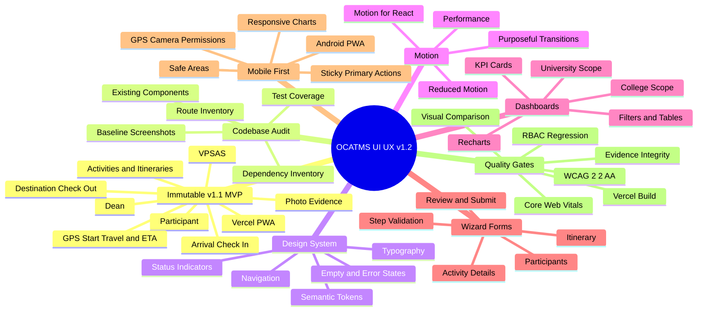

# MarSU OCATMS — UI/UX Polish Mind Map v1.2

## Dependency sequence
Codebase audit → baseline screenshots → dependency validation → design tokens → participant flows → dashboards/charts → wizard forms → accessibility/performance → regression testing → Vercel preview.

## Scope warning
The diagram represents a proposed polishing workflow, not a verified map of the actual repository.
